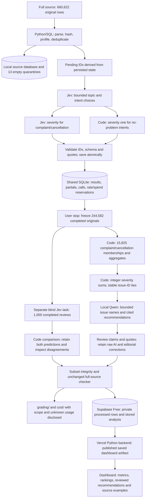

# Pipeline architecture and achieved scope

The orchestrator owns input/output paths, record accounting, validation, cache keys, pending work, checkpointing, request admission and budgets. Models judge bounded language; code owns arithmetic. Exact-text reuse matches model, effort, prompt and schema and retains direct original provenance. The measured pilot demonstrates real interruption/resume and zero-call warm replay. One worker was used for paid business classification. A separate authorized live benchmark tested one and two workers under the same limits/cache conditions: peak 1/2, 20.29/19.35 seconds, equal consumption. Its single-trial time difference is not a sustained pipeline speedup; no provider Batch discount is claimed.

The common stage handoffs are saved review IDs/text plus rubric → validated labels → blind predictions/disagreements → membership and aggregates → deterministic ranking/claims → bounded metrics and quote packs → raw AI and reviewed recommendations. Local sentiment uses pinned VADER. Source ratings are metadata, and human golden answers never enter model payloads.

Requests contain at most 50 reviews. Shared transactional rate/spend reservations precede network I/O. Known project API usage plus the separately authorized $0.05 unknown-charge hold stays within $4.80. A new unknown charge stops dispatch. There are zero stronger-model fallbacks. The saved production run used no automatic retries; the revised dispatcher caps known-usage invalid/transient retries at one with backoff/jitter, while unknown outcomes stop admission. Tests use isolated transport fixtures; the actual paid transient failure and its still-unknown charge remain disclosed. Actual failed attempts are retained, not converted into successes or zero usage.

The user requested stopping after the current request. A tested SQLite admission gate blocked increasing reservations while allowing the in-flight request to settle. The worker saved its results and removed its own lock; no in-flight request was signaled. The gate then became an explicit stopped `enrich` role, permitting only the already-authorized verification and local analysis. Scheduled follow-ups are paused. Classification does not resume automatically after billing reconciliation.

Full-file ingestion and completed analysis are different scopes. The stopped subset contains completed originals only; partial outputs and unexpanded duplicate aliases remain outside the final analysis. Selection depends on intent and execution stage, so it is not representative. The unchanged full-source checker reports missing outputs and unavailable usage. Subset integrity checks verify source/provenance/arithmetic but do not certify semantic accuracy or award a grade.

Supabase stores every completed subset row privately and saves six analysis artifacts. Public access is limited to published aggregates and selected quotes. The backend uses a publishable read key; no model key, database-admin URI or password is deployed. Dashboard visits read saved data and do not run inference. Client COPY uploads are resumable and measured against a 450 MiB safety stop; no paid upgrade is authorized.

The [post-run editorial review](reports/completed_subset/ranking_sensitivity.md) uses saved records to test sensitivity to `needs_review` flags. It changes neither required baseline nor classifications and introduces no model calls. The revised memo recommends investigating usability and playback together because the first-place group changes in this diagnostic. Current repository prose and the [latest revision manifest](submission/checklist_revision_manifest.json) are later than the frozen v1.0.0 execution package. The live dashboard retains the original baseline metrics, ranking and claims; its recommendations and explanations include the later editorial review.

Topic agreement is measured against the original student labels. The student reports accepting the model topic for most disputed cases after reviewing the disagreements, which motivated continuing with the frozen configuration. This qualitative review is recorded separately from original scores and does not constitute a new accuracy measurement.

## Role contracts and why models are called

| Stage / owner | Instructions and input | Output and saved evidence |
|---|---|---|
| Prepare / Python–SQLite | Parse the input CSV; preserve original fields/IDs; hash, profile, quarantine empty texts and queue pending work. | [Full ingestion](reports/full/ingestion.json), [quarantines](reports/full/quarantine.jsonl), local source/state database. |
| Enrich / Jev plus local code | [Frozen questions/configuration](reports/completed_subset/configuration.json) interpret original text using common definitions; ≤50 reviews/request. Jev judges topic/intent and conditional complaint/cancellation severity. Code assigns severity 1 to no-problem intents; local VADER scores sentiment; code validates IDs/quotes/schema. | `grading/records.jsonl` in the evidence ZIP, [schema](specs/GRADING_CONTRACT.md), per-attempt payload/response handoffs and [calls](grading/calls.jsonl). |
| Verify / separate blind Jev task | Original texts and fixed rubric, without enrichment labels; separate verification instructions, [saved comparison](reports/completed_subset/verification.json) and cache. Model interpretation checks another judgment, not a different model's independence. | Second predictions, agreements/disagreements and [inspection decisions](reports/completed_subset/verification_review.json). |
| Group / code; name / Qwen | Code maps complaint/cancellation topics to stable issue IDs. Separate Qwen naming prompt/schema receives aggregate evidence and selected quotes, keeps IDs and supplies short names. It does not decide membership. | [Membership](reports/completed_subset/membership.csv), [aggregate evidence](reports/completed_subset/aggregate_evidence.json); naming request/response artifacts in the ZIP. |
| Rank / code | Sum integer severity; count × unrounded mean; descending sum, ascending issue ID on a tie. Display means at six decimals with half-up rounding. | [Ranking](reports/completed_subset/ranking.csv), [claims](reports/completed_subset/claims.csv), saved-output replay. |
| Recommend / Qwen plus editorial review | Separate writing prompt/schema receives ranked metrics, claim IDs and selected exact quotes. Interpret evidence into concise actions; code renders all numbers and validates references. Review wording against evidence and limitations. | [Raw AI recommendations](reports/completed_subset/recommendations_ai_raw.json), [raw memo](reports/completed_subset/memo_ai_raw.md), [reviewed memo](reports/completed_subset/memo.md), [current recommendations](reports/completed_subset/recommendations.json). |

Jev calls interpret text; Qwen calls name groups and draft actions. Code performs grouping and ranking together before Qwen naming, despite the six conceptual stages in the diagram. Exact instructions and structured schemas for naming/writing are in [analysis.py](src/spotify_pipeline/analysis.py); saved request payloads preserve the actual run inputs. Every role has a separate task, input, output and saved evidence, even where the same model is used. SQLite checkpoints preserve completed IDs. Interruption resumes pending work with unchanged settings; invalid known-usage responses can retry once under the revised dispatcher, while unknown paid outcomes stop dispatch. Publishing saves reviewed artifacts in Supabase; the backend retrieves them and serves the dashboard.
